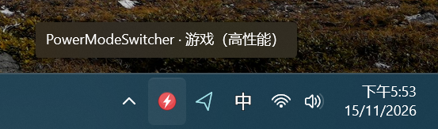

# PowerModeSwitcher

> 一个不到 1000 行的 Windows 托盘小工具：按一次 `Alt+Q`，在 **日常 / 游戏 / 静音** 三档电源模式之间循环切换，屏幕底部闪一条 0.9 秒的提示。

<p>
  
  
  
  
  
</p>

`PowerModeSwitcher` 只做一件事：用 Windows 自带的 `powercfg` 切电源计划，给高频操作配一个键。

**它不做什么**：不碰风扇曲线、不调显卡功耗墙、不改进程优先级、不注入游戏。就是一个电源计划开关。

## 宣传图

小红书用的 9 张竖版宣传图（1080×1440），点开看大图：

[](marketing/xiaohongshu/)

文案与发布说明见 [`marketing/xiaohongshu/文案.md`](marketing/xiaohongshu/)，渲染脚本是 [`marketing/render_xhs.py`](marketing/render_xhs.py)。

---

## 界面

一次切换会在鼠标所在屏幕的底部中央浮出一条提示（点击穿透、不抢焦点）：


托盘图标跟随实际电源计划变色，悬停显示当前模式：



右键是控制面板：当前状态、快捷键状态、三档直选、以及几个维护项。


首次启动会自动注册开机自启，并给一条气泡确认：


---

## 功能

| 能力 | 说明 |
| :--- | :--- |
| 一键循环 | `Alt+Q`（可改）在 日常 → 游戏 → 静音 → 日常 之间轮转 |
| 托盘左键 | 单击图标即切换，不用键盘 |
| 状态不说谎 | 每次切换前用 `powercfg /getactivescheme` 回读系统实际状态，不信内部计数器；你在 Windows 设置里手动改过计划，下一次切换依然正确 |
| OSD 反馈 | 预创建窗口，切换时只改文本和位置；75% 不透明、圆角、白字、900 ms 自动消失、点击穿透、不抢焦点 |
| 多显示器 | OSD 出现在鼠标所在显示器的工作区底部居中，按该屏 DPI 缩放字号 |
| 隐藏计划自救 | Win11 把「高性能/节能」藏起来时，先试原生 GUID；失败则按**对应的原生模板**复制并重命名，把新 GUID 写回配置——绝不用「平衡」复制后改名冒充 |
| 单实例 | 重复启动只会替换旧实例，不会出现两个托盘图标 |
| 零依赖 | 只用 `powercfg.exe` 和系统 API，不装驱动、不需要管理员权限、不联网 |
| 可诊断 | `logs/YYYY-MM-DD.log` 记录每次切换、退出码、`powercfg` 原始输出；`--selftest` 一键输出环境自检 |

---

## 快速开始

### 方式一：装了 AutoHotkey 的话

1. 安装 [AutoHotkey v2](https://www.autohotkey.com/)（装 v2，不是 v1）。
2. 下载本仓库，双击 `PowerModeSwitcher.ahk`。
3. 托盘出现图标即可用。

### 方式二：绿色便携包

把 `PowerModeSwitcher.ahk`、`config.ini`、三个 `.ico` 与官方 `AutoHotkey64.exe`（v2 便携版）放进同一个目录，双击 `start.cmd`。

> 本仓库不提交 AHK 运行时二进制（1.2 MB，GPLv2），请自行从官网下载，或用已安装的 v2 打开脚本。

### 默认对应关系

| 模式 | 电源计划 | 原生 GUID |
| :--- | :--- | :--- |
| 日常 | 平衡 | `381b4222-f694-41f0-9685-ff5bb260df2e` |
| 游戏 | 高性能 | `8c5e7fda-e8bf-4a96-9a85-a6e23a8c635c` |
| 静音 | 节能 | `a1841308-3541-4fab-bc81-f71556f20b4a` |

循环方向固定为 **日常 → 游戏 → 静音 → 日常**。当前激活的计划不属于这三者时（比如主板厂商自建的计划），按「日常」对待。

---

## 使用

| 操作 | 效果 |
| :--- | :--- |
| `Alt+Q` | 切到下一档 |
| 左键单击托盘图标 | 同上 |
| 右键单击托盘图标 | 打开菜单 |
| 菜单 · 三个模式 | 直接跳到某一档，当前项带勾 |
| 菜单 · 重新读取当前电源计划 | 手动在系统设置改过之后，同步图标与状态 |
| 菜单 · 恢复原生电源计划 GUID | 把配置里被改写的 GUID 还原成 Windows 原生的，用于重测 |
| 菜单 · 开机自启 | 一键开关 `shell:startup` 快捷方式 |
| 菜单 · 打开配置文件 / 日志目录 | 直达 |

改完 `config.ini` 要重启程序才生效（托盘 → 退出 → 重新双击）。

---

## 配置

```ini
[General]
Hotkey=Alt+Q          ; 支持 Alt+Q 与 ^!q 两种写法
OSD_Duration=900      ; 停留毫秒
OSD_Opacity=191       ; 0-255，191 ≈ 75%
OSD_FontSize=15       ; 96 DPI 基准点数，按屏幕 DPI 自动缩放
OSD_BottomMargin=80   ; 距屏幕底部留白（96 DPI 基准像素）
StartWithWindows=1    ; 1 开 / 0 关
TrayLeftClick=1       ; 1 = 左键切换；0 = 左键弹菜单

[Mode1]
Name=日常              ; OSD 前半段
PowerPlanName=平衡     ; OSD 后半段
PowerPlanGuid=…        ; 实际调用的计划，程序在创建副本后会自动改写这一行
NativeGuid=…           ; 复制计划时的模板来源，一般不用动
TrayIcon=icon_balanced.ico
```

热键同时接受 `Alt+Q`（人类写法）和 `^!q`（AHK 符号写法：`^`Ctrl `!`Alt `+`Shift `#`Win），程序内部会归一化——因为 AHK 的 `Hotkey()` 只认符号，直接写 `Alt+Q` 会报 `Invalid hotkey`。

---

## 工作原理

```
按下 Alt+Q
   │
   ├─ powercfg /getactivescheme  ── 回读真实状态，定位当前档位
   ├─ 计算下一档（跳过已确认不可用的档位）
   ├─ powercfg /setactive <GUID>
   │     └─ 失败 → 试原生 GUID
   │              └─ 失败 → powercfg -duplicatescheme <原生模板>
   │                       ├─ powercfg -changename <新GUID> "高性能"
   │                       ├─ 写回 config.ini
   │                       └─ 再激活；仍失败则标记该档不可用
   ├─ powercfg /getactivescheme  ── 再回读一次，校验是否真的切过去了
   ├─ 换托盘图标 + 重建菜单
   └─ OSD：改文本 → 量文字尺寸 → 移到目标屏幕底部居中 → 显示 → 900 ms 后隐藏
```

几个刻意的设计决定：

**1. 状态永远来自系统，不来自内存。** 内部只缓存「某档是否可用」，从不缓存「当前是哪档」。所以你用系统设置、主板工具、`powercfg` 命令行改了计划，程序下一次切换依然基于真实状态计算。

**2. 启动阶段不动电源计划。** 常见写法是在启动时把三档各 `setactive` 一次来探测可用性——那会让每次开机都把计划乱切三遍、最后停在「节能」。本实现改为**惰性解析**：某个档位第一次被切到时才做「激活 → 回退原生 → 复制模板」的探测，结果缓存到本次运行结束。启动时只读不写。

**3. 复制计划必须用对应模板。** 如果「高性能」真的不可用，用「平衡」复制一份改名成「高性能」是自欺欺人——功耗行为完全不同。所以模板永远取该档自己的 `NativeGuid`，取不到就判定该档不可用并在循环里跳过，而不是拿别的东西糊上去。

**4. OSD 窗口只创建一次。** 启动时建好隐藏窗口，切换时只改文本、量尺寸、移动、显示。每次新建窗口会带来可见的闪烁和 GC 抖动。

**5. `powercfg` 的退出码和输出都要落盘。** 失败不静默：解析不了当前计划、激活失败、复制失败、重命名失败，全都有日志行，含退出码和原始输出片段。

---

## 常见问题

**按了 `Alt+Q` 没反应？**
看 `logs/` 当天文件里有没有「热键已注册」。没有就是键位写法无效，换成 `Alt+Q` 或 `^!q`。

**快捷键和别的软件冲突怎么办？**
AHK 走键盘钩子而不是 `RegisterHotKey`，第三方抢同一个组合时本程序通常察觉不到（表现为两个程序都被触发）。换一个组合即可，程序只会在**写法无效**时报警。

**切换后图标和实际计划不一致？**
程序每次切换后会再回读一次并写日志。出现「实际计划与目标不一致」，说明有别的软件（主板厂商控制中心之类）在抢着改电源计划，去那边关掉自动切换。

**OSD 看不到？**
独占全屏游戏、部分播放器全屏、UAC 安全桌面下不显示，这是设计限制，不保证覆盖。

**系统里多出「高性能 (2)」「节能 (2)」？**
说明原生计划不可激活，程序按规则复制了对应模板。想回原生：托盘右键 →「恢复原生电源计划 GUID」，然后重启程序。

**杀软/SmartScreen 报警？**
AHK 脚本本身不签名，部分杀软对 AHK 敏感。本仓库不提交任何 exe，自己装的官方 AHK 运行时也在白名单范围内。

**会不会和主板厂商的工具打架？**
会。GIGABYTE Control Center、Armoury Crate、MSI Center 之类都会写电源计划。要么关掉它们的自动切换，要么别同时用。

---

## 目录结构

```
PowerModeSwitcher/
├─ PowerModeSwitcher.ahk   主程序（单文件，840 行）
├─ config.ini              配置
├─ icon_balanced.ico       日常（环形 / 蓝）
├─ icon_performance.ico    游戏（闪电 / 红）
├─ icon_powersave.ico      静音（月牙 / 灰绿）
├─ start.cmd               便携包启动器（配合 AutoHotkey64.exe）
├─ docs/images/            README 用图
├─ logs/                   运行时生成
└─ dev/                    开发与验收脚本
   ├─ make_icons.py        多尺寸 ICO 生成（Pillow）
   ├─ drive_test.py        端到端验收：真按键 + 截图 + powercfg 核对
   ├─ fallback_test.py     原生回退 / 配置写回 / 不可用跳过
   ├─ cfg_write_test.py    写回只改目标行
   ├─ osd_shot.py          OSD 取证书
   ├─ menu_test.py         托盘菜单截图
   ├─ smoke.py             交付形态冒烟测试
   └─ shot.py / crop.py    截图工具
```

---

## 开发与测试

验收不是"看着像能用"，而是脚本驱动的：

```bash
# 环境自检：AHK 版本、配置解析、计划可见性、DPI、OSD 几何、复制/重命名/删除往返
AutoHotkey64.exe PowerModeSwitcher.ahk --selftest   # 结果写入 logs/selftest.txt

# 端到端：发真实键盘事件，逐次回读 powercfg 校验，切换瞬间截图取证
python dev/drive_test.py
```

实测记录（Windows 11 Insider 26300，3840×2160 @150%）：

- 启动不改动电源计划
- 连续 4 次 `Alt+Q`：平衡 → 高性能 → 节能 → 平衡，逐次核对系统实际计划
- OSD 物理尺寸 247×80，底部居中，连按 3 次只有 1 个 OSD 窗口（不叠层），1.2 s 后隐藏
- 托盘左键切换成功且不弹菜单（`0x404 + WM_LBUTTONUP` 被吞掉）
- 把某档 GUID 改成无效值 → 回退原生并写回 `config.ini`，42 行文件只改 1 行
- 把某档两个 GUID 都改坏 → 该档标记不可用，循环自动跳过去切下一档

踩过的 AHK v2 坑（都写在代码注释里）：`Map` 类被同名变量遮蔽导致静默不赋值、`static x := <多行>` 不生效、变量名大小写不敏感（`L` 与 `&l` 是同一个变量）、`Gui` 自动 DPI 缩放只缩宽高不缩坐标。

---

## 兼容性

- Windows 10 / 11（x64）。不依赖 Win11 专有 API。
- AutoHotkey v2.0+（v1 不兼容）。
- 已在 Win11 Insider 26300 + 3840×2160@150% 单屏实机验证；多屏与混合 DPI 的逻辑已实现并做了坐标换算，但没有多屏硬件可测，欢迎反馈 issue。

---

## 许可

[MIT](LICENSE) —— 代码随意取用。

仓库不含 AutoHotkey 运行时。AutoHotkey 本体为 GPLv2，从 [autohotkey.com](https://www.autohotkey.com/) 获取。
