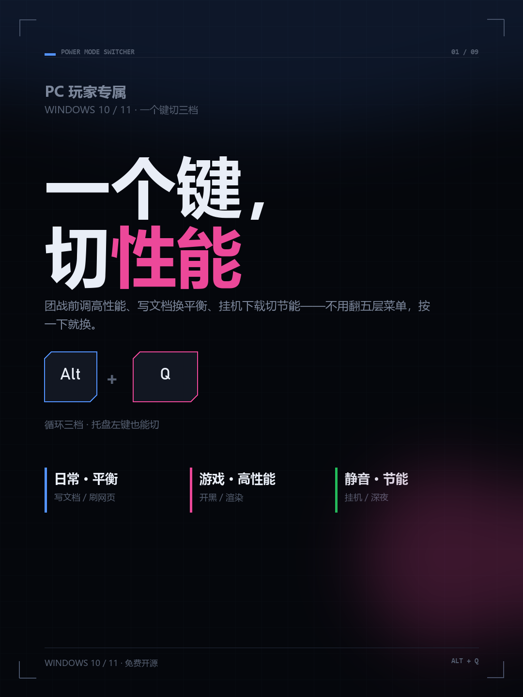
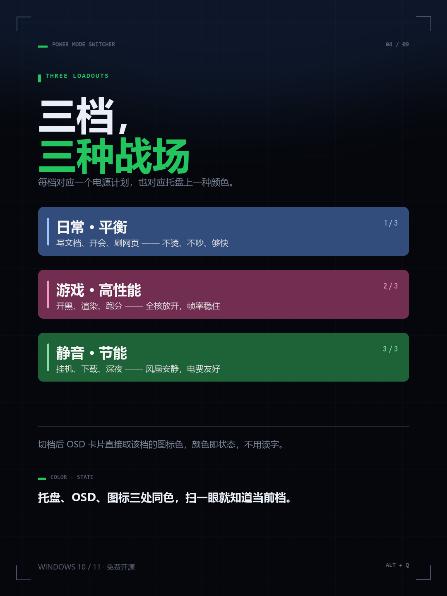
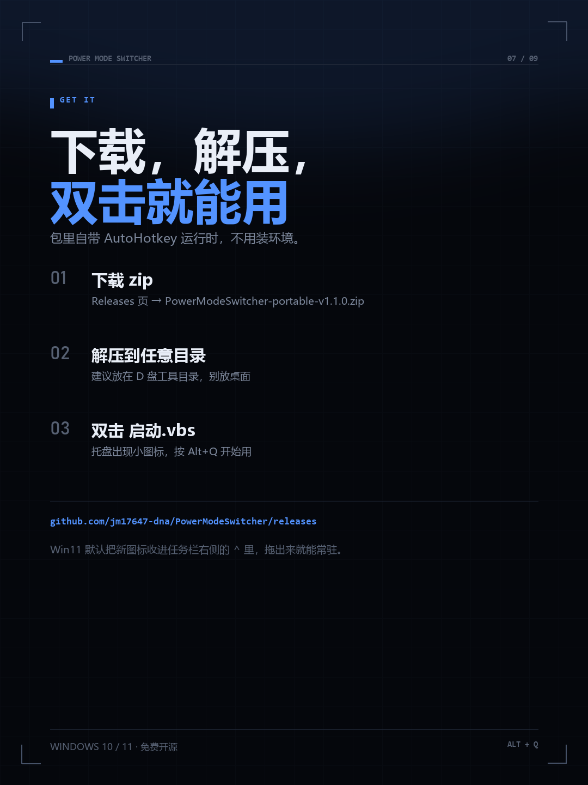
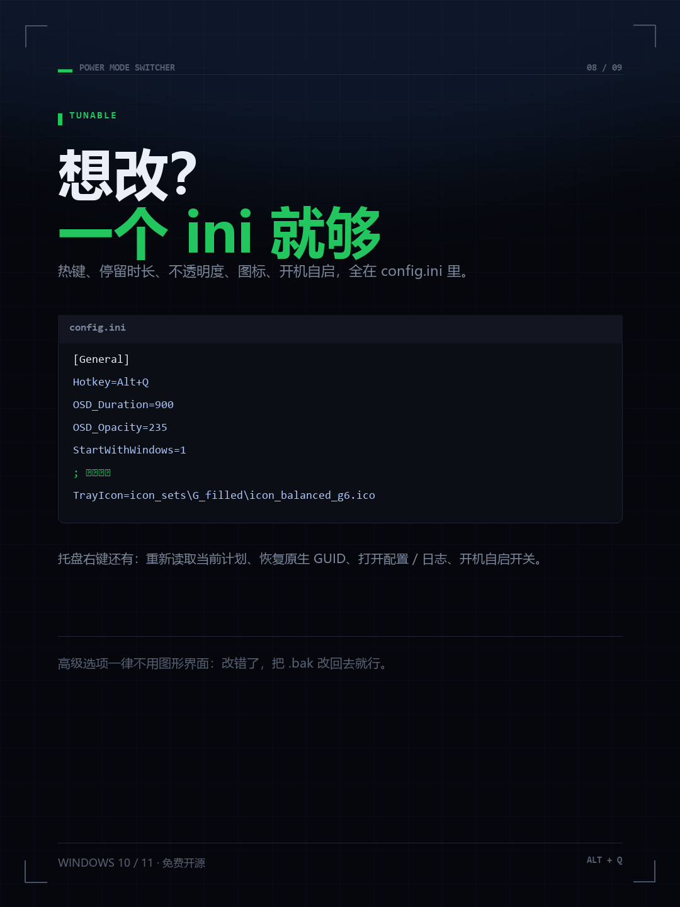
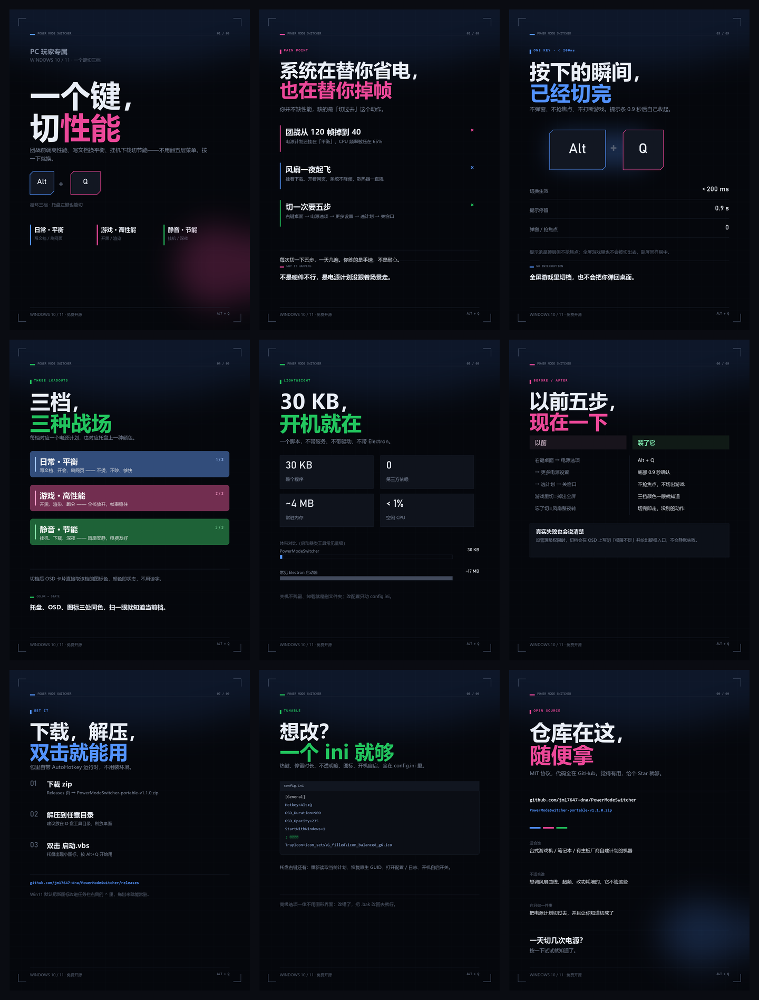

# PowerModeSwitcher

> 给 PC 玩家的一个键：`Alt+Q` 在三档电源模式之间循环切换。30 KB 的托盘工具，不装服务、不带驱动、不占后台。

<p>
  
  
  
  
  
</p>



---

## 它解决什么

你并不缺性能，缺的是「切过去」这个动作。

- **团战从 120 帧掉到 40** —— 电源计划还挂在「平衡」，CPU 频率被压在 65%，风扇也不会跟着走。
- **风扇一夜起飞** —— 挂着下载、开着网页，系统不降频，散热器整晚在吼。
- **切一次要五步** —— 右键桌面 → 电源选项 → 更多电源设置 → 选计划 → 关窗口。一天几遍。

PowerModeSwitcher 只做一件事：把这五步压成一个键，并且让你一眼看出切成了哪档。

---

## 一个键，三种战场

| 档位 | 电源计划 | 颜色 | 什么时候用 |
| :--- | :--- | :--- | :--- |
| **日常 · 平衡** | 平衡 `381b4222…` | 蓝 `#5393FF` | 写文档、开会、刷网页 —— 不烫、不吵、够快 |
| **游戏 · 高性能** | 高性能 `8c5e7fda…` | 玫红 `#EC4899` | 开黑、渲染、跑分 —— 全核放开，帧率稳住 |
| **静音 · 节能** | 节能 `a1841308…` | 绿 `#22C55E` | 挂机、下载、深夜 —— 风扇安静，电费友好 |

循环方向固定 **日常 → 游戏 → 静音 → 日常**。当前激活的计划不属于这三者时（比如主板厂商自建的方案），按「日常」对待。



切档时屏幕底部浮出一张卡片，颜色就是档位颜色；三档颜色在托盘图标、OSD、配置里保持一致。

---

## 按下 Alt+Q 之后发生什么

1. **回读系统真实状态** —— `powercfg /getactivescheme`，不信内部计数器。你在 Windows 设置里手动改过，下一次切换依然正确。
2. **切换电源计划** —— 原生 GUID 优先；Win11 把「高性能 / 节能」藏起来时，按对应原生模板复制并重命名，把新 GUID 写回配置（绝不用「平衡」改名冒充）。
3. **驱动电源滑块（可选）** —— 静音档把 Windows「电源模式」滑块压到最佳能效，离开时恢复原值，失败只写日志。
4. **显示 0.9 秒的 OSD** —— 0.9 秒后自己收起，点击穿透、不抢焦点，全屏游戏里也不会把你弹回桌面。

切换本身通常在 **200 ms 内**完成；OSD 只是回执，不是等待。

---

## 轻量到什么程度

| 指标 | 数值 |
| :--- | :--- |
| 程序本体 | **30 KB** 一个脚本 |
| 第三方依赖 | **0**（只用 `powercfg` 与系统 API） |
| 常驻内存 | **~4 MB**（含 AutoHotkey 运行时） |
| 空闲 CPU | **< 1%** |
| 后台服务 / 驱动 / 开机项 | 无服务、无驱动；可在托盘里一键开关开机自启 |

关机不残留，卸载就是删文件夹，改配置只动 `config.ini`。

---

## 以前 / 现在

| 以前 | 装了它 |
| :--- | :--- |
| 右键桌面 → 电源选项 → 更多电源设置 → 选计划 → 关窗口 | `Alt + Q` |
| 游戏里切 = 掉出全屏 | 不抢焦点，不切出游戏 |
| 忘了切 = 风扇整夜转 | 三档颜色一眼就知道当前档 |
| 切坏了不知道 | 失败会写明原因（如「权限不足」），不会静默失败 |

---

## 安装

### 方式一：下载即用（推荐）

到 [Releases](https://github.com/jm17647-dna/PowerModeSwitcher/releases) 下载 `PowerModeSwitcher-portable-v1.1.0.zip`，解压到任意目录，双击 **启动.vbs**。

包里自带 AutoHotkey 2.0 便携运行时，**不用装环境**：

```
PowerModeSwitcher/
├── 启动.vbs                  ← 双击这个
├── start.cmd                 ← 命令行版启动（能看到报错）
├── PowerModeSwitcher.ahk     ← 主程序
├── config.ini                ← 配置（热键、时长、图标都在这）
├── AutoHotkey64.exe          ← 便携运行时（GPLv2）
├── Lib\UIA.ahk               ← 风扇联动用的 UI 自动化库
├── icon_sets\G_filled\       ← 三档托盘图标
├── 诊断.cmd                   ← 一键收集环境信息，出问题先跑它
└── 第三方组件说明.txt          ← 运行时与图标的许可证来源
```



> Win11 默认把新图标收进任务栏右下角的 `^` 里，拖出来就能常驻。

### 方式二：自己装 AutoHotkey

1. 安装 [AutoHotkey v2](https://www.autohotkey.com/)（装 v2，不是 v1）。
2. 下载本仓库，双击 `PowerModeSwitcher.ahk`。

### 方式三：想让风扇也跟着切

托盘右键 → **免 UAC 提权启动**（创建一个需要时才提权的计划任务）。仅当你需要 GIGABYTE Control Center 的风扇模式联动，或者需要修改电源滑块时，才需要这一步。

---

## 配置

全部选项都在 `config.ini`，改完重启程序即可生效，不用重新编译。



```ini
[General]
Hotkey=Alt+Q
OSD_Duration=900
OSD_Opacity=235        ; 0-255，235 约等于 92%
OSD_FontSize=15
OSD_BottomMargin=80
StartWithWindows=1
TrayLeftClick=1
OSD_OnStart=1          ; 启动时给一次回执
```

托盘右键还有：重新读取当前计划、恢复原生 GUID、打开配置文件、打开日志目录、开机自启开关。

---

## 常见问题

**托盘没有图标？**
Win11 默认收进 `^` 溢出区，点开 `^` 拖出来即可。程序不弹窗、不建主窗口，所以「双击没反应」多半是它已经在跑了。

**按 Alt+Q 没反应？**
先看 `logs/YYYY-MM-DD.log`。热键注册失败会写 `ERROR 热键注册失败`——通常是 Alt+Q 被别的软件占用了，改 `config.ini` 里的 `Hotkey`。

**切档提示「权限不足」？**
你的账号当前令牌改不了电源计划（Low IL 或组策略限制）。用托盘菜单的「免 UAC 提权启动」重开一次。

**风扇没跟着切？**
风扇联动读的是 GIGABYTE Control Center 的界面，需要管理员权限，普通权限下会跳过并写日志。全屏程序里也会主动跳过，避免抢焦点。

**电源滑块没动？**
`PowerSetActiveOverlayScheme` 在非管理员下返回 `rc=5`，日志里会写明。提权启动后可解决。

**想完全卸载？**
托盘退出 → 删掉文件夹 → 在「启动应用」里移除 `PowerModeSwitcher` 快捷方式。

---

## 开发

```
PowerModeSwitcher.ahk     主程序（约 1500 行，AHK v2）
config.ini                默认配置
Lib/UIA.ahk               UI Automation 库（风扇联动）
icon_sets/                图标源（A/B/C/D/E/F/G 多套方案，默认用 G_filled）
docs/                     体检报告、图标对比、OSD 设计稿
marketing/xiaohongshu/    宣传图（render_xhs_v2.py 生成，1080×1440）
dev/                      一次性诊断脚本，不入库
```

自检与演示：

```bat
AutoHotkey64.exe PowerModeSwitcher.ahk --selftest     :: 环境自检，写 logs/selftest.txt
AutoHotkey64.exe PowerModeSwitcher.ahk --demo-osd     :: 循环展示三档 OSD
AutoHotkey64.exe /validate PowerModeSwitcher.ahk      :: 只做语法校验
```

日志按天写 `logs/YYYY-MM-DD.log`，默认保留 14 天（`LogKeepDays`）。

---

## 许可与来源

- 本项目代码：MIT，见 [LICENSE](LICENSE)。
- AutoHotkey v2 运行时：GPLv2，随便携包分发，源码见 <https://github.com/AutoHotkey/AutoHotkey>。
- 图标：基于 [kubai-icons](https://icons.kubai.design/)（MIT）重新栅格化。

宣传物料（9 张，1080×1440）在 `marketing/xiaohongshu/`，由 `marketing/render_xhs_v2.py` 生成：


